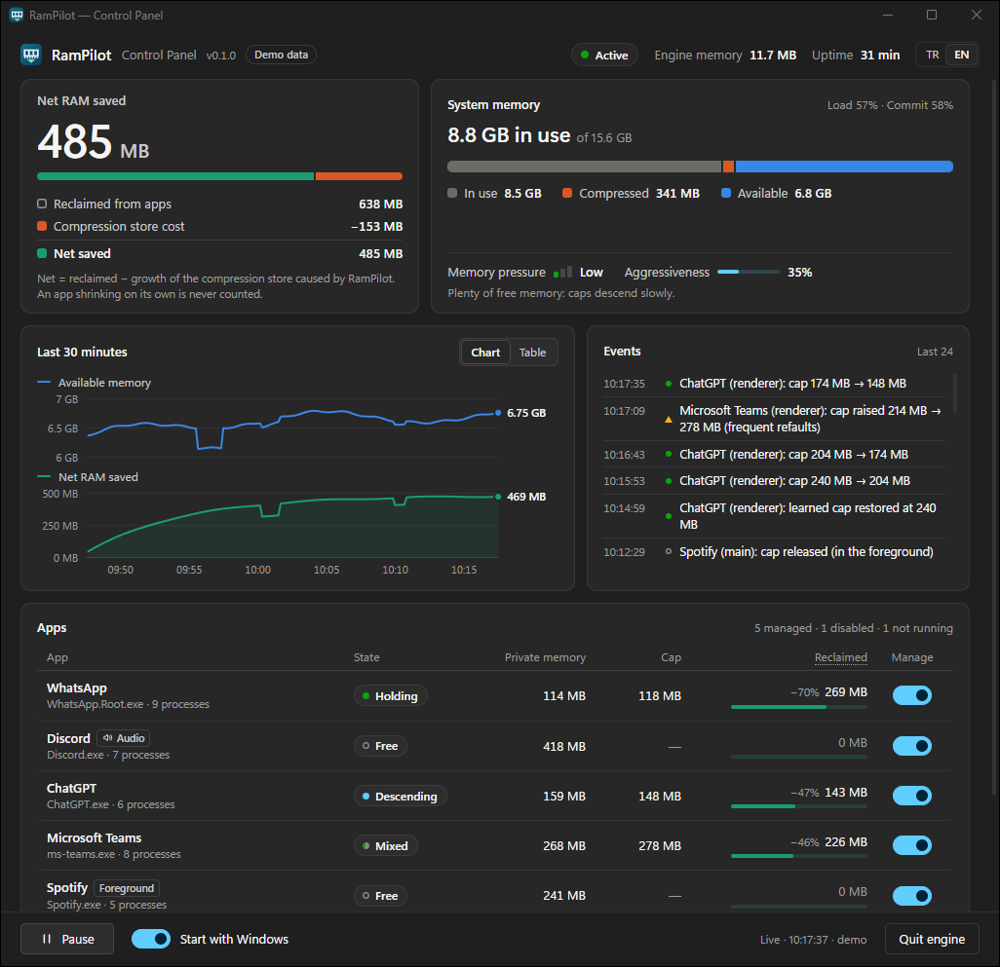
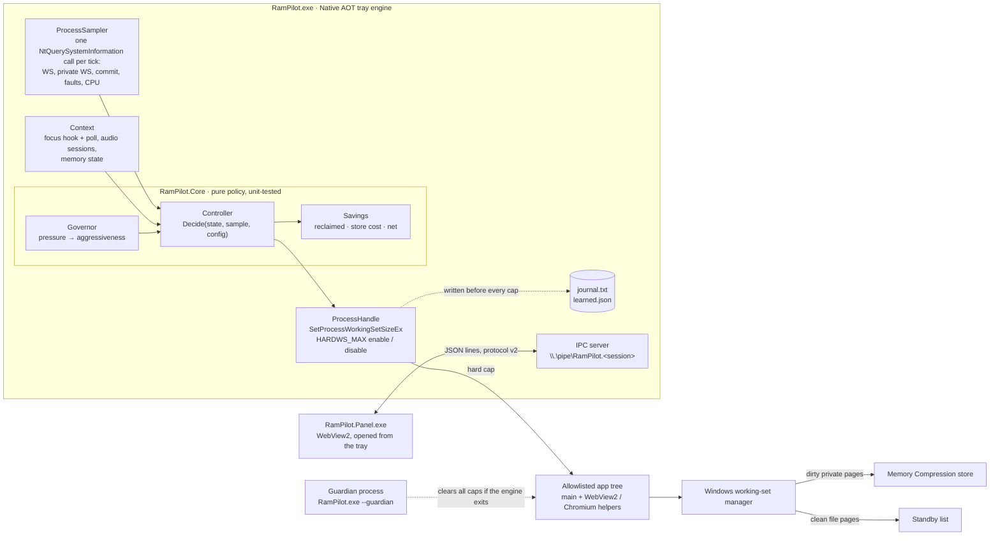
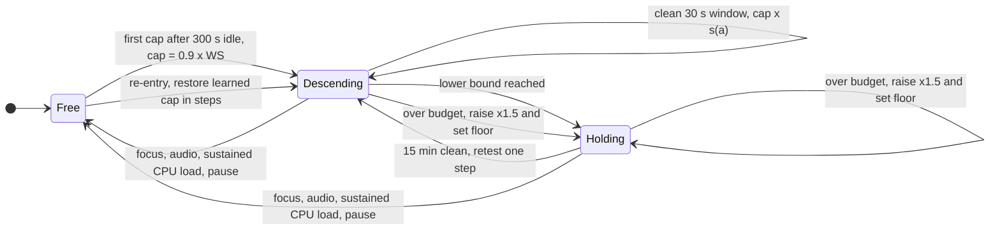
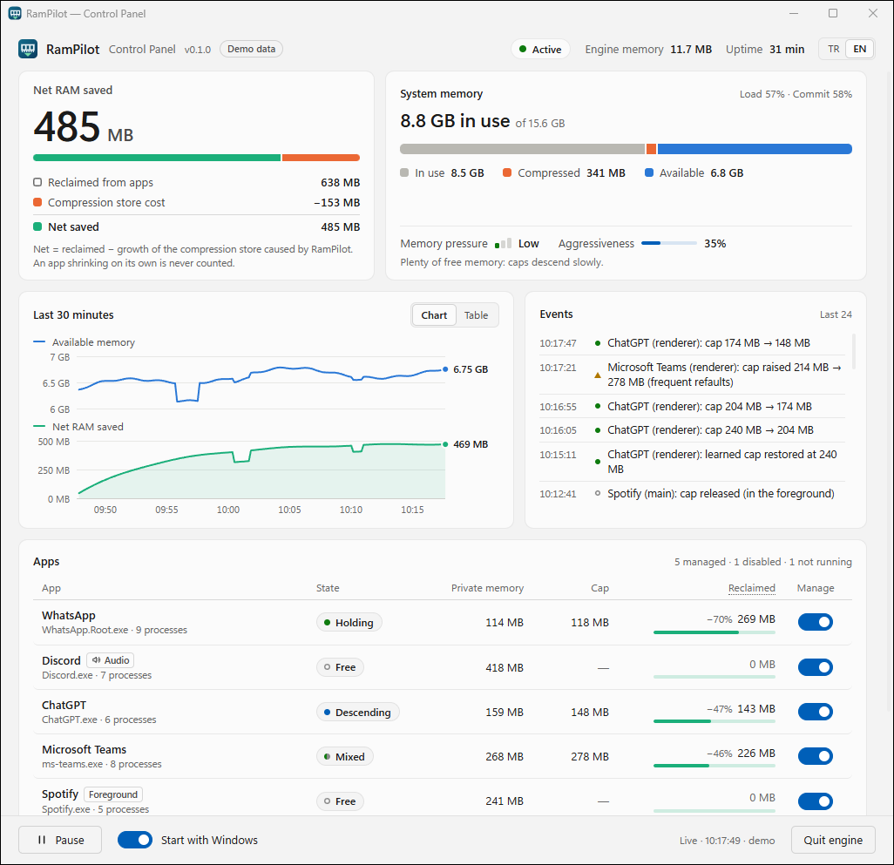
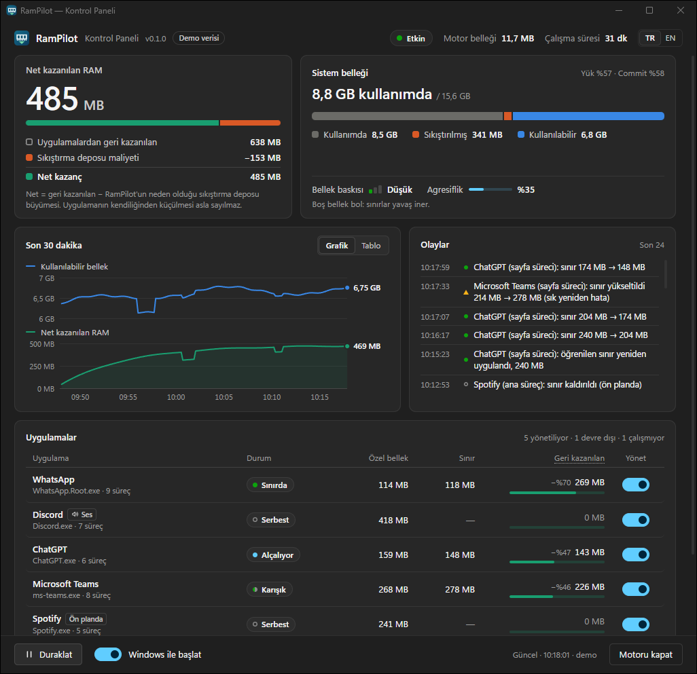

<p align="center">
  
</p>

<h1 align="center">RamPilot</h1>

<p align="center">
  <b>Lowers the RAM used by idle background apps on Windows.</b><br>
  Gradual, feedback-controlled working-set limits for Discord, WhatsApp, Teams, Slack and other Electron / WebView2 apps.<br>
  Measured and reversible. Not a RAM cleaner.
</p>

<p align="center">
  <a href="https://github.com/ilkerprdal/RamPilot/actions/workflows/ci.yml"></a>
  <a href="LICENSE"></a>
  
  
  
</p>

<p align="center">
  <a href="#how-it-works">How it works</a> ·
  <a href="#safety-model">Safety</a> ·
  <a href="#install-and-quick-start">Install</a> ·
  <a href="#faq">FAQ</a> ·
  <a href="docs/DESIGN.md">Design</a> ·
  <a href="experiments/README.md">Experiments</a> ·
  <a href="bench/README.md">Benchmark</a> ·
  <a href="README.tr.md">Türkçe</a>
</p>

<p align="center">
  
  <br>
  <sub>The control panel in its built-in demo mode. The numbers in this screenshot are simulated, not measured.</sub>
</p>

RamPilot is an open-source Windows tool that lowers the memory of idle background apps by applying gradual, feedback-controlled working-set limits, instead of purging memory the way RAM cleaners do.
It is free and runs in the notification area. It sets a hard working-set limit on each idle process of an allowlisted
app, lowers that limit in small steps, and raises it again as soon as the app starts faulting pages back in. The app
you are using is never limited. RamPilot runs without administrator rights, installs no driver, injects no code and
makes no network connections. It is early software (0.1.0): the mechanism is measured, but the benchmark that would
show how much memory it saves in daily use has not been run yet.

> [!NOTE]
> **Early release (0.1.0).** The controller is unit-tested against a simulated process, and the kernel behaviour
> it relies on was measured with synthetic probes ([experiments](experiments/README.md)). Evidence on real apps is
> limited to the live runs reported under [Results so far](#results-so-far). The [benchmark](bench/README.md) has been specified
> but not run yet. Tested on Windows 11 build 26200 only.

## Who is this for

RamPilot may help if:

- Discord, WhatsApp, Teams, Slack, ChatGPT, Notion or Spotify stay open all day and each holds several hundred MB
  while you are not using them.
- You have 8–16 GB of RAM and run those apps next to a browser, a game or a build.
- You tried a RAM cleaner and saw the freed memory come back within minutes, with stutter when you switched apps.
- You want to see what was actually saved, with the compression-store cost subtracted.

It will not help if:

- You are running out of *committed* memory (page file full, "out of memory" errors). RamPilot lowers resident
  memory only; commit does not change.
- The memory is used by the app in front of you. The focused app is never limited.
- Your machine rarely runs low on memory. Windows' default behaviour is fine there.
- You want it to manage every process on the system. It manages an allowlist of apps and nothing else.

## Why idle apps hold so much RAM

Chat and assistant apps built on Electron or WebView2 (WhatsApp, Discord, ChatGPT, Slack, Teams) each carry their own
Chromium. When they sit in the background, much of their working set is cold: caches, old heap, start-up code.
Windows leaves those pages resident until the whole system is short of memory. RamPilot moves them out earlier, one
small step at a time, and stops as soon as an app starts paying for it in page faults. The approach follows Meta's
[TMO and senpai](#acknowledgements), adapted to what Windows exposes.

## Highlights

<table>
  <tr>
    <td width="33%" valign="top"><b>Gradual, feedback-controlled</b><br>A hard working-set cap starts at 90&nbsp;% of the working set and walks down in steps of at most 15&nbsp;%, only while the measured refault cost stays under a stall budget.</td>
    <td width="33%" valign="top"><b>Built on measured kernel behaviour</b><br>The first cap waits until 5&nbsp;minutes after you last used the app, because that is when the Windows working-set manager starts to tell hot pages from cold ones. Short background notification bursts do not reset that clock.</td>
    <td width="33%" valign="top"><b>Learns each app</b><br>Per app, image and process role it remembers the last good cap and a floor after every raise. It reuses them on the next idle period instead of probing again.</td>
  </tr>
  <tr>
    <td valign="top"><b>Demand-aware</b><br>A governor reads memory load, commit charge and the kernel's low-memory signal. It scales how deep and how fast caps go.</td>
    <td valign="top"><b>Out of your way</b><br>The focused app and apps playing or recording audio are released at once and never capped; so are apps under sustained CPU load. Brief notification bursts are not treated as use.</td>
    <td valign="top"><b>Fails toward "no limit"</b><br>Journal before every cap, a guardian process, a startup scan, fail-closed process classification and a deny list nobody can override.</td>
  </tr>
  <tr>
    <td valign="top"><b>Honest numbers</b><br>Reclaimed memory, compression-store cost and net savings are reported separately. The headline is net.</td>
    <td valign="top"><b>Small</b><br>Native AOT engine, a single 3.6&nbsp;MB exe using about 10–13&nbsp;MB of private memory. The panel only runs while it is open.</td>
    <td valign="top"><b>Local and unprivileged</b><br>No admin rights, no driver, no code injection, no network access, no telemetry.</td>
  </tr>
</table>

## How RamPilot differs from a RAM cleaner

"RAM cleaners" call `EmptyWorkingSet` on a timer or a button. That evicts hot and cold pages alike. The app faults
its hot pages straight back in, the "freed" number disappears within minutes, and you pay with stutter when you
switch back.

| | RAM cleaner (`EmptyWorkingSet` loop) | Windows default | RamPilot |
|---|---|---|---|
| When it acts | Timer or button | When the system runs short of memory | Proactively, on apps that have been idle for minutes |
| How much it removes | Everything, at once | What the memory manager needs | At most 10&nbsp;% at first, then at most 15&nbsp;% per step, while refaults stay under budget |
| Hot pages | Evicted, then faulted back | Mostly kept | Kept in synthetic tests: later steps kept 94–100&nbsp;% of the hot set |
| Feedback | None | System-wide | Per process: page faults (minus the app's own baseline), hard faults, CPU, focus, audio |
| Foreground app | Often trimmed too | Not targeted | Never capped |
| Reported number | "Freed" RAM: gross and short-lived | n/a | Net: reclaimed minus compression-store growth |
| Scope | Often every process | Every process | Allowlisted apps only; the built-in deny list always wins |

## How it works

### Architecture



One main loop owns all state and samples on a fixed 2-second cadence. The focus hook, tray and IPC threads only post
work to it. All policy lives in `RamPilot.Core`, which has no P/Invoke, no I/O and no clock. The engine is a thin
Win32 shell around it. The full design is in [`docs/DESIGN.md`](docs/DESIGN.md), and the protocol is in
[`docs/IPC.md`](docs/IPC.md).

### The controller

Each managed process is in one of three states:



**The feedback loop.** On every tick the engine reads the page-fault delta of each capped process. A fault only counts
as a *refault* while the working set is at the cap, because only then does a new page force an eviction. The app's
own fault rate, learned while it was uncapped and idle, is subtracted. Refaults are priced at 30&nbsp;µs and hard
faults (disk reads) at 2&nbsp;ms. The total is compared with a stall budget of about 1&nbsp;ms per second:

- A 30-second window clearly under budget lowers the cap one step: `cap × s(a)`, at most 15&nbsp;%.
- A window over budget, or a single tick ten times over it, raises the cap by 1.5× and records a floor 10&nbsp;% above
  the failed cap. Later descents stop at that floor, so a periodic GC does not cause an endless sawtooth.
- The cap that survived a clean window becomes the learned cap. It is persisted per (app, image, role). After the app
  was used, it is restored step by step, without a new probe: first 0.9× the current working set, then 10-second
  steps of at most 15&nbsp;%. Each step is still cost-checked.
- A holding cap retests one step lower after 15 clean minutes.

The budgeted costs are deliberately pessimistic. The measured CPU cost of a refault is 0.8–7&nbsp;µs, but a burst
lands on the UI thread exactly when the user comes back. A budget that is too high only costs savings. One that is
too low costs latency.

**The governor.** System memory state sets an aggressiveness *a*, which scales three things: how deep caps may go
(depth limit = reference working set × (1 − *a*)), the step size, and the stall budget.

| Pressure | When (any of) | *a* | Caps stop at | Step | Stall budget |
|---|---|---|---|---|---|
| Low | otherwise | 0.4 | 60&nbsp;% of the working set at descent start | ×0.895 | 0.9&nbsp;ms/s |
| Medium | available < 25&nbsp;%, commit > 80&nbsp;% | 0.75 | 25&nbsp;% | ×0.869 | 1.25&nbsp;ms/s |
| High | low-memory notification, available < 10&nbsp;%, commit > 90&nbsp;% | 1.0 | floor or 32&nbsp;MB | ×0.85 | 1.5&nbsp;ms/s |

Escalation is immediate. De-escalation waits 60&nbsp;s. When pressure falls, existing caps are not raised or released;
the shallower depth limit only stops further descent.

> [!IMPORTANT]
> **What was measured about the Windows kernel.** RamPilot's policy is built on probes run with a synthetic worker
> process. Each probe recorded per-page residency through `QueryWorkingSetEx`. Raw data and method are in
> [experiments/README.md](experiments/README.md).
> - **The first trim under a new hard cap evicts in insertion order, not by access.** After 30, 60 or 120&nbsp;s of
>   idleness, it kept the same 37&nbsp;% of hot and cold pages (9 of 9 runs). After 300&nbsp;s idle it kept the
>   whole hot set in 5 of 6 runs, and 73.5&nbsp;% in the sixth. Hence the 5-minute idle rule and the gentle
>   0.9× first cap.
> - **Once a process is capped, replacement follows recency.** Each further 15&nbsp;% step kept 94–100&nbsp;% of the hot set.
> - **`HardFaultCount` does not see compression-store reads.** It stayed at 0 across 884,736 store refaults. RamPilot
>   therefore uses the page-fault count minus the app's baseline as its signal.
> - **A trim does not free RAM at once.** With memory to spare, trimmed dirty pages can wait on the modified list,
>   which is not counted as "available", until the modified page writer compresses them.
> - **Removing a cap can itself trim** if the soft maximum is small. RamPilot restores a soft maximum of
>   `max(original, 2 × WS, 64 MB)`.
>
> These results come from one machine, and the mechanism behind them is inferred: Microsoft does not document it.

## Results so far

<!-- RESULTS -->
Everything below was measured on one machine (Intel Core Ultra 5 245KF, 16 GB DDR5, Windows 11 26200, memory
compression on) on 2026-11-13. Each row links to its raw data. The cross-tool [benchmark](bench/README.md) has
**not** been run yet, so there is no headline "GB saved" figure here on purpose.

| What | Result | Source |
|---|---|---|
| **How cold is an idle chat app?** | Idle WhatsApp main process: a fixed 102&nbsp;MB cap on a 256&nbsp;MB working set drew only ~155 page faults in 60&nbsp;s. Its idle hot set was ~13–16&nbsp;MB, so ~94&nbsp;% of the resident memory went untouched. *(Fixed-cap experiment, not the controller.)* | [experiments, phase 0](experiments/README.md) |
| **Does the kernel keep the hot set?** | Not on the first cap of a freshly active process: eviction is by insertion order (hot and cold kept alike, 37&nbsp;%). After 300&nbsp;s idle the hot set survived (100&nbsp;% in 5 of 6 runs, 73.5&nbsp;% in one), and gradual ×0.85 steps kept 94–100&nbsp;% of it. This is why the controller waits 5&nbsp;minutes and starts at 0.9× the working set. | [probe A](experiments/README.md), ≥ 3 runs per case |
| **What does a refault cost?** | ~0.8&nbsp;µs per page from standby, ~1.65&nbsp;µs from the compression store, ~7&nbsp;µs from disk (file cache). `HardFaultCount` stayed at 0 across 884,736 store refaults, so the controller budgets all faults, not hard faults. | [probe B](experiments/README.md) |
| **Controller on a live app** | WhatsApp, 11&nbsp;min: caps started below the working set and stepped down ×0.9 every 30&nbsp;s; a refault spike raised the cap ×1.5 within one tick and set a floor; after an activity release the learned cap (40.9&nbsp;MB) came back without a new probe. | [tests/live](tests/live/evidence-2026-11-13.txt) |
| **The app you use is left alone** | 20-minute run of the release binary while WhatsApp was in use on and off: no cap was applied, because every focus restarted the 5-minute clock. | engine metrics, 2026-11-13 |
| **Caps are cleared when the engine is killed** | `Stop-Process -Force` on the engine while WhatsApp was capped (twice): the guardian cleared 2 and 3 limits in 4–6&nbsp;ms. A limit planted by another process was cleared by the startup scan. 0 limits left after every run. | [tests/live](tests/live/evidence-2026-11-13.txt) |
| **Engine footprint** | Single 3.6&nbsp;MB Native AOT exe, about 10–13&nbsp;MB private memory, 2&nbsp;s sampling. | engine diagnostics |

Not yet measured: net savings over hours on a memory-constrained machine, focus-switch latency, and the A/B/C
comparison against no tool and an `EmptyWorkingSet` cleaner. Those are what the [benchmark](bench/README.md) is for;
results, including unfavourable ones, will be published there.
<!-- /RESULTS -->

## Screenshots

| Dark | Light |
|---|---|
|  |  |

<details>
<summary><b>Turkish panel and the tray icon</b></summary>
<br>

<p align="center">
  
</p>

<p align="center">
  <br>
  <sub>The engine lives in the notification area. Left click opens the panel. Right click gives Pause, Resume and Quit.</sub>
</p>
</details>

The panel screenshots use the built-in demo mode, so their values are simulated.

## How savings are measured

Trimming a working set is easy to make look good, so RamPilot reports three numbers:

| Number | How it is computed |
|---|---|
| **Reclaimed** (gross) | For each managed process: the private working set it would have without a cap, minus what it has now. The counterfactual scales the entry value by the process's own commit charge, which caps do not affect. An app shrinking or growing on its own is not credited. |
| **Store cost** | Reclaimed × *r*, where *r* is measured for each trim: the growth of the Memory Compression store over the next ~30&nbsp;s versus the bytes trimmed. *r* is clamped to [0.25, 1], because pages can sit uncompressed on the modified list first. |
| **Net** | Reclaimed minus store cost. This is the number shown in the tray and the panel. |

Also worth knowing:

- Committed memory (private bytes) does not go down. If you are hitting the commit limit, RamPilot does not help.
- Windows' "available" memory includes the standby list, and it does not count dirty pages that are waiting on the
  modified list. The system-level effect of a trim can therefore show up late.
- `HardFaultCount` cannot see compression-store reads. "0 hard faults" says nothing about refaults, so RamPilot
  does not report it as evidence.
- The counterfactual is an estimate. There is no holdout app yet; see the [roadmap](#roadmap).

## Safety model

RamPilot changes how much RAM other programs may keep resident, so every design choice errs toward "no limit".

- **Allowlist only.** Only process trees whose root image is in `config.json → apps` are touched. WebView2 helpers
  are only touched below such a root. Recycled PIDs are detected by creation time.
- **Built-in deny list.** Anti-cheat, game clients and launchers, security software, Windows-critical processes,
  RamPilot itself, and anything under common game install paths are never touched. The list is compiled in, applied
  when the configuration is loaded and checked again before a process is opened. It cannot be overridden.
- **Never in your way.** Focusing a window releases its whole app tree at once. So does an active audio session
  (30&nbsp;s hold), sustained CPU load (busy more than half of the last minute, 30&nbsp;s hold), pausing, or
  disabling the app. Short bursts, such as a chat app handling a notification, do not release a cap; if a burst
  needs evicted pages, the refault-cost rule raises the cap within one tick. No process is capped before it is
  5&nbsp;minutes old and 5&nbsp;minutes have passed since it was last used.
- **Fail-closed classification.** GPU, audio-service and crash-handler helpers are recognised from their command
  line. If a command line cannot be read, the process is excluded.
- **Journal before cap.** Every capped process instance is written to disk before the cap is applied. If the write
  fails, no cap is applied.
- **Guardian.** A watchdog process waits on the engine. When the engine exits for any reason, including a Task
  Manager "End task", the guardian clears every cap and exits. Caps are only tightened while the guardian is alive.
- **When both die.** "End process tree" in Task Manager kills the guardian too. The caps then stay on those
  processes until one of three things happens: the next engine start clears them (its startup scan removes every
  hard limit on allowlisted processes), you run `RamPilot.exe --recover`, or the capped process exits.
- **Uncap without trimming**, and a **startup self-check** of the undocumented process-table layout: the engine
  refuses to run if its own entry does not match documented APIs.
- **Unprivileged and local.** It runs as the invoking user (`asInvoker`) and needs no admin rights. It uses query
  and set-quota rights only: no memory writes, no code injection, no driver. It makes no network connections.

Threat model and vulnerability reporting: [`SECURITY.md`](SECURITY.md). What is stored locally:
[`docs/PRIVACY.md`](docs/PRIVACY.md).

## Install and quick start

### Requirements

- Windows 10 21H2 or later, or Windows 11, x64. Tested on Windows 11 build 26200 only.
- Memory Compression enabled. It is on by default; check with `Get-MMAgent`.
- For the panel: the WebView2 Runtime (preinstalled on Windows 11) and the .NET 10 Desktop Runtime. The engine is
  self-contained.

### Download

1. Get `RamPilot-<version>-win-x64.zip` and `SHA256SUMS.txt` from
   [Releases](https://github.com/ilkerprdal/RamPilot/releases).
2. Verify the download:
   ```powershell
   Get-FileHash .\RamPilot-<version>-win-x64.zip -Algorithm SHA256   # compare with SHA256SUMS.txt
   gh attestation verify .\RamPilot-<version>-win-x64.zip --repo ilkerprdal/RamPilot
   ```
3. Extract it to a folder you own, for example `%LOCALAPPDATA%\Programs\RamPilot`, and run `RamPilot.exe`.

The binaries are not code-signed yet, so SmartScreen may warn. Every release is built by GitHub Actions and carries
a build-provenance attestation.

### Build from source

Prerequisites: the .NET 10 SDK ([`global.json`](global.json)), Visual Studio Build Tools with "Desktop development
with C++" (needed by Native AOT), and the WebView2 Runtime.

```powershell
git clone https://github.com/ilkerprdal/RamPilot.git
cd RamPilot
.\build.ps1            # stops a running engine safely, runs the tests, publishes to artifacts\publish
.\build.ps1 -Start     # same, then starts the engine
```

### Usage

```text
RamPilot.exe                         run in the tray (if already running, open the panel)
RamPilot.exe --minutes 15            run for 15 minutes, then release every cap and exit
RamPilot.exe --recover               remove hard limits left on allowlisted processes, then exit
RamPilot.exe --summary [--detail]    print managed apps and their memory, then exit
RamPilot.exe --config <path>         use another configuration file
```

"Start with Windows" in the panel adds a per-user `Run` registry value. Nothing is installed system-wide.

## Configuration

`%LOCALAPPDATA%\RamPilot\config.json` is created with defaults on first run. Comments and trailing commas are
allowed, and keys you leave out keep their defaults. Out-of-range values are clamped, with a warning in the log.
Deny-listed apps are dropped. The excerpt below shows the defaults of the most relevant keys:

```jsonc
{
  "version": 1,
  // Allowlist. Defaults: WhatsApp, Discord, ChatGPT, Slack, Teams (new and classic), Notion, Spotify
  "apps": [
    { "exe": "WhatsApp.Root.exe", "name": "WhatsApp" },
    { "exe": "Discord.exe", "name": "Discord" }
  ],
  "helpers": ["msedgewebview2.exe"],   // child images managed below an allowlisted root
  "excludeCommandLine": [],            // extra command-line markers that exclude a process
  "policy": {
    "tickSeconds": 2,
    "firstCapIdleSeconds": 300,        // idle time before the first cap (min 120)
    "minProcessAgeSeconds": 300,
    "focusGraceSeconds": 60,           // wait after focus before re-capping
    "startRatio": 0.9,                 // first cap = 0.9 x working set
    "stepFactor": 0.85,                // per-step factor at full aggressiveness
    "stepSeconds": 30,
    "minCapMb": 32,
    "stallBudget": 0.001,              // 1 ms of estimated stall per second
    "refaultCostUs": 30,
    "hardFaultCostUs": 2000
  },
  "governor": {
    "lowAggressiveness": 0.4,          // 0 = never cap while pressure is low
    "mediumAggressiveness": 0.75,
    "highAggressiveness": 1.0,
    "mediumAvailPct": 25,
    "highAvailPct": 10
  }
}
```

The same folder holds `learned.json` (learned caps and floors), `journal.txt` (caps currently applied),
`rampilot.log`, `guardian.log` and `metrics_*.csv` (the last 20 runs). All of it stays on your machine. Every key and
its range are documented in [`src/RamPilot.Core/EngineConfig.cs`](src/RamPilot.Core/EngineConfig.cs) and
[`docs/DESIGN.md`](docs/DESIGN.md).

## Repository structure

```text
RamPilot/
├── src/
│   ├── RamPilot.Core/          Pure policy, no P/Invoke, no I/O: Controller, Governor, Savings,
│   │                           RoleClassifier, DenyList, EngineConfig, LearnedProfiles, ProcessSnapshot
│   ├── RamPilot.Engine/        RamPilot.exe, the Native AOT tray engine
│   │   ├── Win32/              ProcessSampler (NtQuerySystemInformation + self-check), ProcessHandle (caps),
│   │   │                       FocusTracker, AudioSessions (IAudioSessionManager2)
│   │   ├── Safety/             Journal (written before every cap), Guardian (watchdog + leftover scan)
│   │   ├── Ipc/                Protocol v2 named-pipe server
│   │   └── Engine.cs, Tray.cs  Main loop: sample → decide → apply → publish; tray icon (EN/TR)
│   └── RamPilot.Panel/         RamPilot.Panel.exe: WinForms + WebView2 host; ui/ holds HTML, CSS, JS, EN/TR strings
├── tests/
│   ├── RamPilot.Core.Tests/    Controller invariants against a simulated process (hot set, GC region, cold memory)
│   └── live/                   Live-run evidence, a dummy target app and a pipe client
├── experiments/                Kernel probes A/B/C, early phase-0/1 notes, raw CSVs
├── bench/                      Benchmark methodology and a PowerShell harness (3 arms, pressure scenario, statistics)
├── docs/                       DESIGN.md, IPC.md, PRIVACY.md, images
├── assets/                     Icon sources (SVG, ICO, PNG)
├── build.ps1                   Build, test and publish to artifacts\publish
└── Directory.Build.props       Shared build settings: warnings as errors, deterministic builds
```

## FAQ

### Is RamPilot a RAM cleaner or RAM optimizer?

No. RAM cleaners empty working sets in one pass (`EmptyWorkingSet` or similar), on a timer or a button, hot pages
included, and the apps fault them straight back in. RamPilot limits only idle, allowlisted apps, removes at most
10&nbsp;% of a process's working set at first and at most 15&nbsp;% per later step, watches page faults, and backs off
when an app needs its memory. It does not purge the system, does not show a number that evaporates a minute later,
and does not claim to make your PC faster. It reports net savings after the compression-store cost.

### How do I reduce Discord (or WhatsApp, Teams, Slack) memory usage on Windows?

These apps are on RamPilot's default list, so there is nothing to configure: start `RamPilot.exe` and leave the app
in the background. Once the app has gone unused for 5 minutes, RamPilot starts lowering its resident memory step by
step. Switching back to the app removes the limit at once; a call or audio playback removes it within one 2-second
tick. What this does not do: it does not shrink the app while you use it, and it does not reduce its committed
memory. How much it saves over a day has not been benchmarked yet; see [Results so far](#results-so-far).

### Which apps does it manage by default?

WhatsApp (`WhatsApp.Root.exe`, `WhatsApp.exe`), Discord, ChatGPT, Slack, Microsoft Teams (new `ms-teams.exe` and
classic `Teams.exe`), Notion and Spotify, including their `msedgewebview2.exe` helper processes. GPU, audio-service and
crash-handler helpers are never limited. The list is the `apps` array in `%LOCALAPPDATA%\RamPilot\config.json`.

### Does it work with other apps, such as Signal, VS Code or Obsidian?

You can add any app that is not on the built-in deny list. Add an entry to the existing `apps` array in
`config.json` (it already holds the defaults; an `apps` array you write replaces the default list), then quit
RamPilot from the tray and start it again:

```jsonc
"apps": [
  { "exe": "WhatsApp.Root.exe", "name": "WhatsApp" },
  // ...the other defaults...
  { "exe": "Signal.exe", "name": "Signal" }
]
```

`exe` is the image name of the app's main process; `name` is optional and only used for display. Only the default
apps have been tried by the author. The policy is tuned for Electron and WebView2 apps, whose idle memory is mostly
cold; for anything else, check the log and the metrics CSV before trusting it.

### Does it work with Chrome, Edge or Firefox?

Browsers are not on the default list and have not been tested. They are not deny-listed, so you can add one, but
browsers already discard or sleep background tabs themselves, and a browser you use all day is rarely idle for the
5 minutes RamPilot waits. Expect little.

### Will it help with games?

Indirectly. Game launchers, anti-cheat, security software and anything under common game library folders (Steam,
Epic, Riot, Battle.net, Xbox and others) are on a compiled-in deny list and are never touched; RamPilot also never
touches an app you have not allowlisted. It does not inject code or read other processes' memory. What it can do is
lower the memory of chat apps idling next to the game. It has no game detection yet, and the effect on a game has not
been measured. Anti-cheat policies are opaque; if you see a problem, pause RamPilot and
[open an issue](https://github.com/ilkerprdal/RamPilot/issues).

### Does it reduce "committed" memory or fix out-of-memory errors?

No. A working-set limit lowers resident (physical) memory only. Private bytes and the commit charge stay the same.

### Is it safe? Can it crash my apps?

A working-set limit cannot corrupt an app; the worst case is that the app runs slower because it has to fault pages
back in, and the controller raises the limit when it sees that. Limits are removed on focus, audio, sustained CPU
load, pause and exit, and a guardian process removes them if the engine is killed. See the
[safety model](#safety-model) for the one case where a limit can outlive RamPilot ("End process tree").

### How is it different from Mem Reduct, Wise Memory Optimizer or RAMMap?

[Mem Reduct](https://github.com/henrypp/memreduct) monitors and cleans system memory: it empties working sets and
the standby and modified page lists, on demand, on a timer or above a usage threshold, and needs administrator rights.
[Wise Memory Optimizer](https://www.wisecleaner.com/wise-memory-optimizer.html) frees RAM with one click, or
automatically when available memory drops below a level you choose.
[RAMMap](https://learn.microsoft.com/sysinternals/downloads/rammap) is a Sysinternals physical-memory analysis tool;
its Empty menu can purge working sets or the standby list by hand, once. It is useful next to RamPilot for checking
results. RamPilot is a continuous per-app controller: it only limits idle allowlisted apps, steps gradually, and uses
page-fault feedback to stop. It is also much younger and less tested than any of them, and it has not been
benchmarked against them.

### Does it cost CPU or battery?

The engine samples every 2 seconds and uses about 10–13&nbsp;MB of private memory. The larger cost is on the Windows
side: compressing trimmed pages, and decompressing any that are touched again. The stall budget keeps refaults rare by
design. Battery impact has not been measured yet; it is part of the benchmark plan.

### I have 32 GB. Will it do anything?

Yes, but less. With plenty of free memory the governor sits at "low" (aggressiveness 0.4). Caps still descend, in
steps of about 10&nbsp;%, but never below 60&nbsp;% of the working set measured when the descent started, and with a
tighter stall budget. Whether that is worth anything depends on what else needs your RAM; on a machine that never
runs low it mostly is not. If you want RamPilot to act only under pressure, set `"governor": { "lowAggressiveness": 0 }`.
At zero aggressiveness nothing is capped.

### Doesn't Windows already do this?

Partly, and well. Windows trims and compresses when the system is under pressure. It does not reclaim cold pages from
specific idle apps *before* pressure builds, with a per-app cost signal. RamPilot helps most on 8–16&nbsp;GB machines
that keep several chat or assistant apps open next to a browser, a game or a build. When memory is plentiful, Windows'
default is fine.

### Why does Task Manager's "In use" barely change?

"In use" includes the compression store and the modified list. Look at the per-process working set and at
"Available" over a few minutes, and at RamPilot's net figure, which already subtracts the store growth.

### Does it need to run as administrator?

No. It is built to run as a normal user and asks for no elevation. Nothing is gained by running it elevated.

## Roadmap

- Run the [benchmark](bench/README.md) (no tool vs. RamPilot vs. an `EmptyWorkingSet` loop, with focus latency and a
  memory-pressure scenario) and publish every result, including the unflattering ones.
- A rotating holdout app, for a measured counterfactual instead of an estimate.
- Governor inputs: back-off on page-file writes, fullscreen/game detection, battery state.
- Predictive release when Alt-Tab starts or the taskbar button is hovered.
- Code signing and a winget package.
- ARM64 (the process-table offsets are only verified on x64).

## Contributing

Bug reports with measurements are the most valuable contribution. So are benchmark runs on other hardware, especially
ones that show RamPilot not helping. See [`CONTRIBUTING.md`](CONTRIBUTING.md), the
[Code of Conduct](CODE_OF_CONDUCT.md) and [`CHANGELOG.md`](CHANGELOG.md). Report security issues privately, as
described in [`SECURITY.md`](SECURITY.md).

## Facts

| | |
|---|---|
| Name | RamPilot |
| What it is | Windows tray tool that lowers the resident memory of idle background apps |
| Method | Hard working-set limits (`SetProcessWorkingSetSizeEx`) lowered step by step under page-fault feedback |
| Default apps | WhatsApp, Discord, ChatGPT, Slack, Microsoft Teams, Notion, Spotify (editable in `config.json`) |
| Never touched | Focused app, apps with active audio, game launchers and game library folders, anti-cheat, security software |
| Platform | Windows 10 21H2+ and Windows 11, x64. Tested on Windows 11 build 26200 only |
| Requirements | No admin rights. Panel needs WebView2 Runtime and .NET 10 Desktop Runtime |
| Licence | MIT |
| Price | Free |
| Network / telemetry | None |
| Status | 0.1.0, early. Benchmark specified, not yet run |
| Source | https://github.com/ilkerprdal/RamPilot |

## License

[MIT](LICENSE). Copyright (c) 2026 RamPilot contributors. Third-party components are listed in
[`THIRD-PARTY-NOTICES.md`](THIRD-PARTY-NOTICES.md).

## Acknowledgements

- Meta's Transparent Memory Offloading: J. Weiner et al.,
  [*TMO: Transparent Memory Offloading in Datacenters*](https://doi.org/10.1145/3503222.3507731), ASPLOS '22. Its
  userspace controller [senpai](https://github.com/facebookincubator/senpai) inspired the cost-driven, gradual
  descent. Windows has no per-process pressure-stall information, so RamPilot estimates stall cost from fault
  counters instead.
- The Windows memory manager and its Memory Compression store, which do the actual work. RamPilot only decides
  *when*, *from which process* and *how much*.
