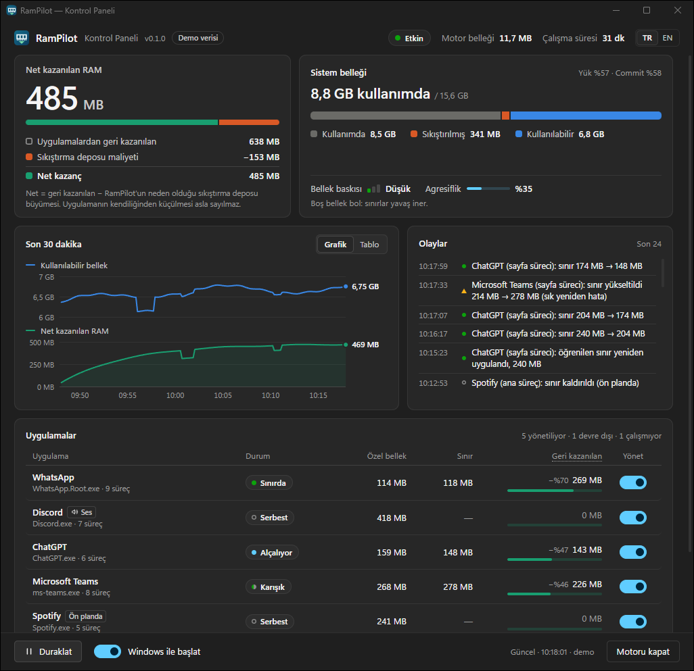
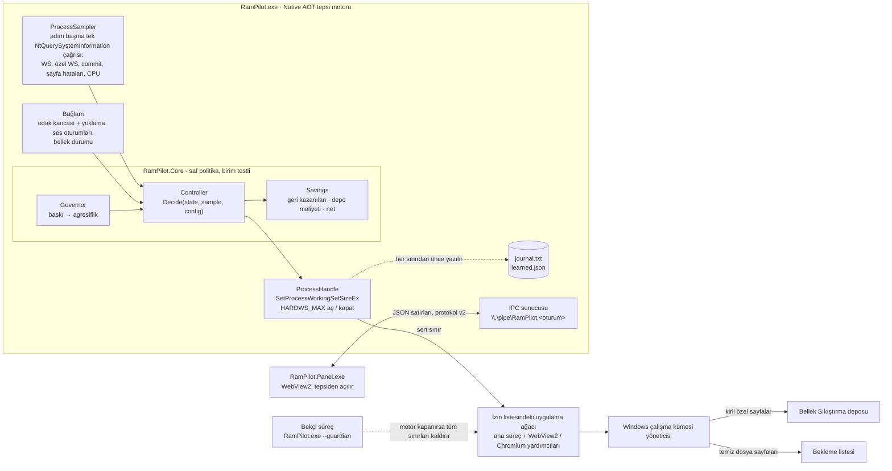
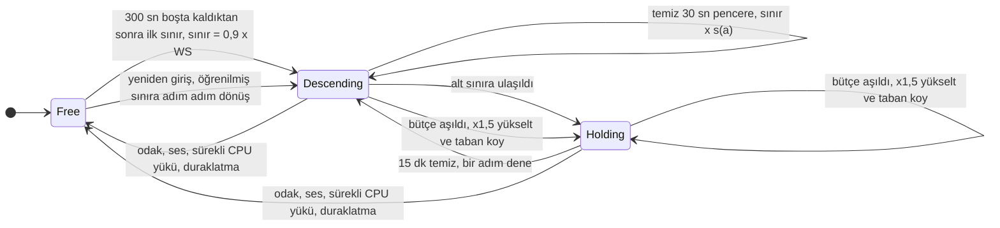
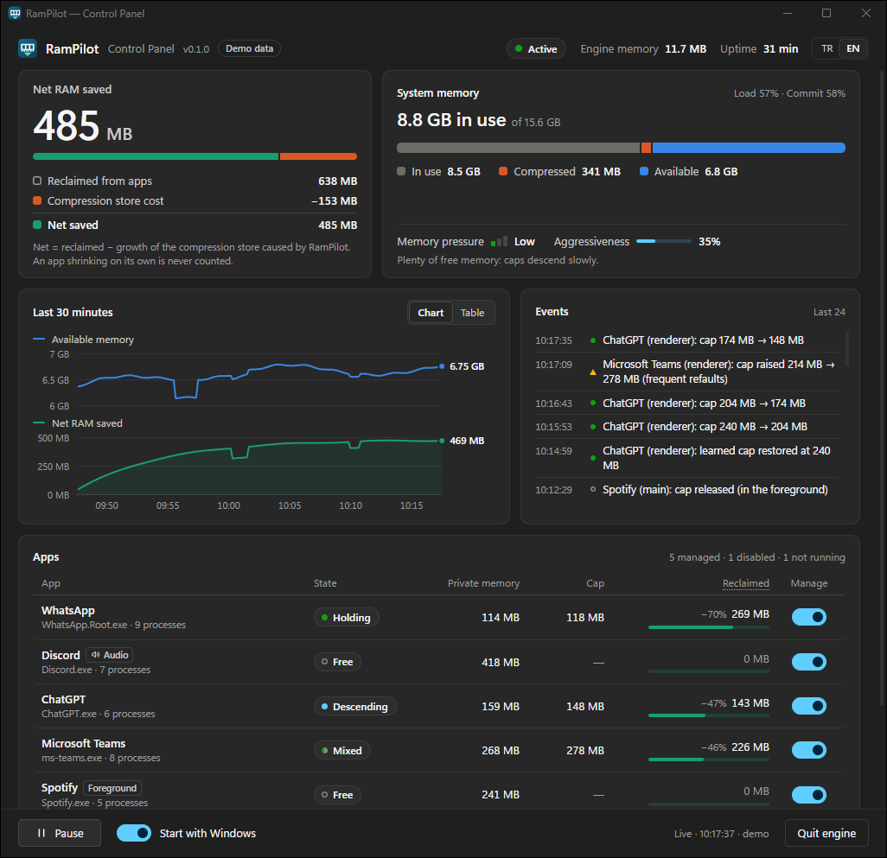
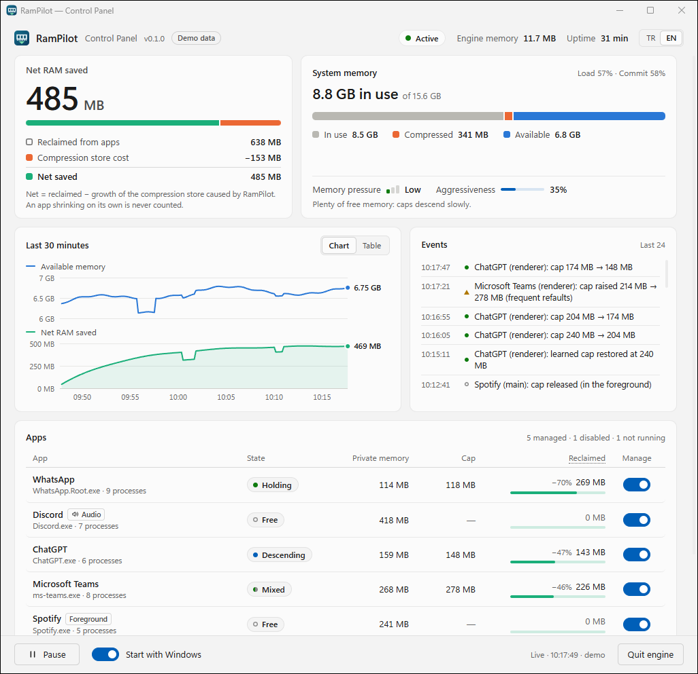

<p align="center">
  
</p>

<h1 align="center">RamPilot</h1>

<p align="center">
  <b>Windows'ta boştaki arka plan uygulamaları için geri beslemeli bellek geri kazanımı.</b><br>
  Ölçerek, kademeli ve geri alınabilir şekilde. RAM temizleyici değildir.
</p>

<p align="center">
  <a href="https://github.com/ilkerprdal/RamPilot/actions/workflows/ci.yml"></a>
  <a href="LICENSE"></a>
  
  
  
</p>

<p align="center">
  <a href="#nasıl-çalışır">Nasıl çalışır</a> ·
  <a href="#güvenlik-modeli">Güvenlik</a> ·
  <a href="#hızlı-başlangıç">Hızlı başlangıç</a> ·
  <a href="docs/DESIGN.md">Tasarım</a> ·
  <a href="experiments/README.md">Deneyler</a> ·
  <a href="bench/README.md">Ölçüm yöntemi</a> ·
  <a href="README.md">English</a>
</p>

<p align="center">
  
  <br>
  <sub>Kontrol paneli, yerleşik tanıtım (demo) modunda. Bu görüntüdeki sayılar ölçüm değil, benzetimdir.</sub>
</p>

> [!NOTE]
> **Erken sürüm (0.1.0).** Denetleyici, benzetilmiş bir sürece karşı birim testleriyle sınandı. Dayandığı çekirdek
> davranışı da yapay süreçlerle yapılan deneylerle ölçüldü ([deneyler](experiments/README.md)). Gerçek
> uygulamalardaki kanıt, [Sonuçlar](#sonuçlar) bölümündeki canlı çalıştırmalarla sınırlı.
> [Karşılaştırmalı ölçüm](bench/README.md) tanımlandı ama henüz yapılmadı. Yalnızca Windows 11 derleme 26200
> üzerinde denendi.

## Neden

Electron ya da WebView2 üzerine kurulu sohbet ve asistan uygulamalarının (WhatsApp, Discord, ChatGPT, Slack, Teams)
her biri kendi Chromium'unu taşır. Arka planda beklerken çalışma kümelerinin (working set) büyük kısmı soğuktur:
önbellekler, eski yığın, açılışta bir kez çalışan kod. Windows bu sayfaları, sistemin tamamı bellek sıkıntısına
düşene kadar RAM'de tutar. RamPilot onları daha erken, her seferinde küçük bir adımla dışarı taşır. Uygulama bunun
bedelini sayfa hatası olarak ödemeye başladığı anda da durur. Yaklaşım Meta'nın [TMO ve senpai](#teşekkür)
çalışmasını izler ve Windows'un sunduğu imkânlara uyarlar.

## Öne çıkanlar

<table>
  <tr>
    <td width="33%" valign="top"><b>Kademeli ve geri beslemeli</b><br>Sert çalışma kümesi sınırı, çalışma kümesinin %90'ından başlar ve en fazla %15'lik adımlarla iner. İner, ama yalnızca ölçülen geri çağırma maliyeti takılma bütçesinin altında kaldıkça.</td>
    <td width="33%" valign="top"><b>Ölçülmüş çekirdek davranışına dayanır</b><br>İlk sınır, uygulamayı en son kullanmanızdan 5 dakika sonrasını bekler. Windows çalışma kümesi yöneticisi sıcak sayfayı soğuktan ancak o zaman ayırt etmeye başlıyor. Arka plandaki kısa bildirim patlamaları bu süreyi sıfırlamaz.</td>
    <td width="33%" valign="top"><b>Her uygulamayı öğrenir</b><br>Uygulama, program ve süreç rolü başına son iyi sınırı ve her yükseltmeden sonra bir tabanı hatırlar. Bir sonraki boşta kalma döneminde baştan yoklamak yerine bunları kullanır.</td>
  </tr>
  <tr>
    <td valign="top"><b>Talebe duyarlı</b><br>Bir yönetici (governor), bellek yükünü, commit yükünü ve çekirdeğin düşük bellek sinyalini okur. Sınırların ne kadar derine ve ne kadar hızlı ineceğini buna göre ayarlar.</td>
    <td valign="top"><b>Ayağınıza dolanmaz</b><br>Odaktaki uygulama ve ses çalan ya da kaydeden uygulamalar hemen serbest bırakılır, asla sınırlanmaz; uzun süreli CPU yükü altındaki uygulamalar da öyle. Kısa bildirim patlamaları kullanım sayılmaz.</td>
    <td valign="top"><b>Her hata "sınır yok"a düşer</b><br>Her sınırdan önce günlük kaydı, bir bekçi süreç, açılış taraması, şüphede dışarıda bırakan süreç sınıflandırması ve kimsenin geçersiz kılamayacağı bir engel listesi.</td>
  </tr>
  <tr>
    <td valign="top"><b>Dürüst sayılar</b><br>Geri kazanılan bellek, sıkıştırma deposu maliyeti ve net kazanç ayrı raporlanır. Öne çıkan sayı nettir.</td>
    <td valign="top"><b>Küçük</b><br>Native AOT motor: 3,6&nbsp;MB'lık tek bir exe, yaklaşık 10–13&nbsp;MB özel bellek. Panel yalnızca açıkken çalışır.</td>
    <td valign="top"><b>Yerel ve yetkisiz</b><br>Yönetici hakkı, sürücü, kod enjeksiyonu, ağ erişimi ve telemetri yok.</td>
  </tr>
</table>

## RAM temizleyici değil

"RAM temizleyiciler" bir zamanlayıcıyla ya da düğmeyle `EmptyWorkingSet` çağırır. Bu, sıcak ve soğuk sayfaları
birlikte atar. Uygulama sıcak sayfalarını hemen geri çeker. "Boşaltılan" sayı birkaç dakikada kaybolur, bedelini de
uygulamaya geri döndüğünüzde takılma olarak ödersiniz.

| | RAM temizleyici (`EmptyWorkingSet` döngüsü) | Windows varsayılanı | RamPilot |
|---|---|---|---|
| Ne zaman devreye girer | Zamanlayıcı ya da düğme | Sistemde bellek azaldığında | Proaktif olarak, dakikalardır boşta olan uygulamalarda |
| Ne kadar alır | Her şeyi, bir kerede | Bellek yöneticisinin ihtiyacı kadar | Önce en fazla %10, sonra adım başına en fazla %15. Geri çağırmalar bütçe içinde kaldıkça |
| Sıcak sayfalar | Atılır, sonra geri çağrılır | Çoğunlukla korunur | Yapay testlerde korundu: sonraki adımlar sıcak kümenin %94–100'ünü tuttu |
| Geri besleme | Yok | Sistem genelinde | Süreç başına: sayfa hataları (uygulamanın kendi tabanı düşülerek), hard fault'lar, CPU, odak, ses |
| Ön plandaki uygulama | Çoğu zaman o da kırpılır | Hedef alınmaz | Asla sınırlanmaz |
| Gösterilen sayı | "Boşaltılan" RAM: brüt ve kısa ömürlü | Yok | Net: geri kazanılan eksi sıkıştırma deposu büyümesi |
| Kapsam | Çoğu zaman tüm süreçler | Tüm süreçler | Yalnızca izin listesindeki uygulamalar. Yerleşik engel listesi her zaman önceliklidir |

## Nasıl çalışır

### Mimari



Tüm durumu tek bir ana döngü yönetir ve 2 saniyelik sabit aralıkla ölçüm alır. Odak kancası, tepsi ve IPC iş
parçacıkları ona yalnızca iş gönderir. Tüm politika `RamPilot.Core` içindedir: P/Invoke, G/Ç ve saat içermez. Motor
onun etrafında ince bir Win32 kabuğudur. Tasarımın tamamı [`docs/DESIGN.md`](docs/DESIGN.md), protokol
[`docs/IPC.md`](docs/IPC.md) belgesinde.

### Denetleyici

Yönetilen her süreç üç durumdan birindedir:



(`Free`: sınır yok · `Descending`: sınır iniyor · `Holding`: öğrenilen seviyede bekliyor.)

**Geri besleme döngüsü.** Motor her adımda, sınırlanmış her sürecin sayfa hatası artışını okur. Bir hata yalnızca
çalışma kümesi sınırdayken *geri çağırma* (refault) sayılır, çünkü ancak o zaman yeni bir sayfa başka bir sayfanın
çıkarılmasını gerektirir. Uygulamanın sınırsız ve boştayken öğrenilen kendi hata hızı düşülür. Geri çağırmalar
30&nbsp;µs, hard fault'lar (diskten okuma) 2&nbsp;ms olarak fiyatlanır. Toplam, saniyede yaklaşık 1&nbsp;ms'lik bir
takılma bütçesiyle karşılaştırılır:

- Bütçenin rahatça altında kalan 30 saniyelik bir pencere, sınırı bir adım düşürür: `sınır × s(a)`, en fazla %15.
- Bütçeyi aşan bir pencere ya da bütçenin on katını aşan tek bir adım sınırı 1,5 kat yükseltir. Başarısız sınırın
  %10 üstüne de bir taban kaydeder. Sonraki inişler bu tabanda durur, böylece periyodik bir GC sonsuz bir testere
  dişine yol açmaz.
- Temiz bir pencereyi atlatan sınır, öğrenilmiş sınır olur. Uygulama, program ve rol başına saklanır. Uygulama
  kullanıldıktan sonra yeniden yoklama yapılmadan adım adım geri getirilir: önce mevcut çalışma kümesinin 0,9 katı,
  sonra en fazla %15'lik 10 saniyelik adımlar. Her adımda maliyet yine denetlenir.
- Bekleyen (holding) bir sınır, 15 temiz dakikadan sonra bir adım aşağısını dener.

Bütçelenen maliyetler bilinçli olarak kötümser. Bir geri çağırmanın ölçülen CPU maliyeti 0,8–7&nbsp;µs. Ama bu
hatalar, kullanıcı geri döndüğü anda arayüz iş parçacığına yığılır. Fazla yüksek bir bütçe yalnızca kazançtan yer;
fazla düşük bir bütçe ise gecikmeye mal olur.

**Yönetici (governor).** Sistemin bellek durumu bir agresiflik *a* belirler. Bu değer üç şeyi ölçekler: sınırların
ne kadar derine inebileceğini (derinlik sınırı = başvuru çalışma kümesi × (1 − *a*)), adım boyunu ve takılma
bütçesini.

| Baskı | Koşul (herhangi biri) | *a* | Sınırların durduğu yer | Adım | Takılma bütçesi |
|---|---|---|---|---|---|
| Düşük | diğer durumlar | 0,4 | inişin başındaki çalışma kümesinin %60'ı | ×0,895 | 0,9&nbsp;ms/sn |
| Orta | kullanılabilir < %25, commit > %80 | 0,75 | %25 | ×0,869 | 1,25&nbsp;ms/sn |
| Yüksek | düşük bellek bildirimi, kullanılabilir < %10, commit > %90 | 1,0 | taban ya da 32&nbsp;MB | ×0,85 | 1,5&nbsp;ms/sn |

Seviye yükselmesi anında olur; düşmesi 60&nbsp;sn bekler. Baskı azaldığında mevcut sınırlar yükseltilmez ya da
kaldırılmaz. Daha sığ derinlik sınırı yalnızca daha fazla inişi durdurur.

> [!IMPORTANT]
> **Windows çekirdeği hakkında ölçülenler.** RamPilot'un politikası, yapay bir işçi süreçle yapılan deneylere
> dayanır. Her deney, `QueryWorkingSetEx` ile sayfa başına bellekte olma durumunu kaydetti. Ham veri ve yöntem
> [experiments/README.md](experiments/README.md) belgesinde.
> - **Yeni bir sert sınır altındaki ilk kırpma, sayfaları erişime göre değil, eklenme sırasına göre çıkarır.**
>   30, 60 ya da 120&nbsp;sn boşta kaldıktan sonra sıcak ve soğuk sayfaların aynı %37'sini tuttu (9 çalıştırmanın
>   9'unda). 300&nbsp;sn boşta kaldıktan sonra 6 çalıştırmanın 5'inde sıcak kümenin tamamını, altıncısında
>   %73,5'ini tuttu. 5 dakikalık boşta kalma kuralı ve yumuşak 0,9× ilk sınır bu yüzden var.
> - **Süreç bir kez sınırlandıktan sonra yer değiştirme yakın kullanıma göre yapılır.** Sonraki her %15'lik adım
>   sıcak kümenin %94–100'ünü tuttu.
> - **`HardFaultCount`, sıkıştırma deposundan okumaları görmez.** 884.736 depo geri çağırmasında 0'da kaldı.
>   RamPilot bu yüzden sinyal olarak, uygulamanın tabanı düşülmüş sayfa hatası sayısını kullanır.
> - **Kırpma RAM'i hemen boşaltmaz.** Bellek bolken, kırpılan kirli sayfalar değiştirilmiş (modified) listede
>   bekleyebilir. Bu liste "kullanılabilir" sayılmaz. Sayfalar ancak değiştirilmiş sayfa yazıcısı onları
>   sıkıştırınca serbest kalır.
> - **Bir sınırı kaldırmak, yumuşak üst sınır küçükse kendi başına kırpma yapabilir.** RamPilot yumuşak üst sınırı
>   `max(özgün, 2 × WS, 64 MB)` olarak geri yükler.
>
> Bu sonuçlar tek bir makineden geliyor. Arkalarındaki mekanizma da çıkarımdır; Microsoft bunu belgelemiyor.

## Sonuçlar

<!-- RESULTS -->
Aşağıdakilerin hepsi tek bir makinede (Intel Core Ultra 5 245KF, 16 GB DDR5, Windows 11 26200, bellek sıkıştırma
açık) 2026-11-13 tarihinde ölçüldü. Her satır ham verisine bağlanıyor. Araçlar arası [karşılaştırmalı test](bench/README.md)
henüz **yapılmadı**; bu yüzden burada bilerek bir "şu kadar GB kazanıldı" manşet rakamı yok.

| Ne | Sonuç | Kaynak |
|---|---|---|
| **Boştaki bir sohbet uygulaması ne kadar soğuk?** | Boştaki WhatsApp ana süreci: 256&nbsp;MB çalışma kümesine konan sabit 102&nbsp;MB sınır, 60&nbsp;sn'de yalnızca ~155 sayfa hatasına yol açtı. Boştaki sıcak kümesi ~13–16&nbsp;MB'tı; yani yerleşik belleğin ~%94'üne hiç dokunulmadı. *(Sabit sınır deneyi, denetleyici değil.)* | [deneyler, faz 0](experiments/README.md) |
| **Çekirdek sıcak kümeyi korur mu?** | Yeni etkin olmuş bir sürecin ilk sınırında hayır: atma sırası belleğe giriş sırası (sıcak ve soğuk aynı oranda, %37 tutuldu). 300&nbsp;sn boşta kaldıktan sonra sıcak küme korundu (6 çalıştırmanın 5'inde %100, birinde %73,5) ve ×0,85'lik kademeli adımlar onun %94–100'ünü tuttu. Denetleyicinin 5 dakika beklemesinin ve çalışma kümesinin 0,9 katından başlamasının sebebi bu. | [prob A](experiments/README.md), her durum ≥ 3 çalıştırma |
| **Bir sayfanın geri istenmesi neye mal olur?** | Bekleme listesinden ~0,8&nbsp;µs, sıkıştırma deposundan ~1,65&nbsp;µs, diskten (dosya önbelleği) ~7&nbsp;µs. `HardFaultCount`, depodan yapılan 884.736 geri okumada 0'da kaldı; bu yüzden denetleyici yalnızca sert hataları değil tüm hataları bütçeler. | [prob B](experiments/README.md) |
| **Canlı bir uygulamada denetleyici** | WhatsApp, 11&nbsp;dk: sınırlar çalışma kümesinin altından başlayıp her 30&nbsp;sn'de ×0,9 indi; bir geri istek patlaması sınırı tek adımda ×1,5 yükseltti ve bir taban koydu; etkinlik sonrası serbest bırakmanın ardından öğrenilmiş sınır (40,9&nbsp;MB) yeni bir yoklama olmadan geri geldi. | [tests/live](tests/live/evidence-2026-11-13.txt) |
| **Kullandığınız uygulamaya dokunulmaz** | WhatsApp'ın aralıklarla kullanıldığı 20 dakikalık sürüm testi: hiç sınır konmadı, çünkü her odaklanma 5 dakikalık sayacı baştan başlattı. | motor ölçümleri, 2026-11-13 |
| **Hiçbir sınır motordan uzun yaşamaz** | WhatsApp sınırlıyken motora iki kez `Stop-Process -Force`: bekçi 2 ve 3 sınırı 4–6&nbsp;ms içinde kaldırdı. Başka bir sürecin koyduğu sınırı açılış taraması temizledi. Her çalıştırmadan sonra 0 sınır kaldı. | [tests/live](tests/live/evidence-2026-11-13.txt) |
| **Motorun ayak izi** | Tek bir 3,6&nbsp;MB Native AOT exe, yaklaşık 10–13&nbsp;MB özel bellek, 2&nbsp;sn örnekleme. | motor tanılama |

Henüz ölçülmedi: belleği sıkışık bir makinede saatler boyunca net kazanç, odak değiştirme gecikmesi ve hiç araç
olmamasına ve bir `EmptyWorkingSet` temizleyicisine karşı A/B/C karşılaştırması. [Karşılaştırmalı test](bench/README.md)
bunun için var; olumsuz olanlar dahil sonuçlar orada yayınlanacak.
<!-- /RESULTS -->

## Ekran görüntüleri

| Koyu | Açık |
|---|---|
|  |  |

<details>
<summary><b>Türkçe panel ve tepsi simgesi</b></summary>
<br>

<p align="center">
  
</p>

<p align="center">
  <br>
  <sub>Motor bildirim alanında yaşar. Sol tık paneli açar. Sağ tıkta Duraklat, Devam ve Çıkış seçenekleri var.</sub>
</p>
</details>

Panel görüntüleri yerleşik tanıtım modundan alındı; değerleri benzetimdir.

## Depo yapısı

```text
RamPilot/
├── src/
│   ├── RamPilot.Core/          Saf politika, P/Invoke ve G/Ç yok: Controller, Governor, Savings,
│   │                           RoleClassifier, DenyList, EngineConfig, LearnedProfiles, ProcessSnapshot
│   ├── RamPilot.Engine/        RamPilot.exe, Native AOT tepsi motoru
│   │   ├── Win32/              ProcessSampler (NtQuerySystemInformation + öz denetim), ProcessHandle (sınırlar),
│   │   │                       FocusTracker, AudioSessions (IAudioSessionManager2)
│   │   ├── Safety/             Journal (her sınırdan önce yazılır), Guardian (bekçi + artık sınır taraması)
│   │   ├── Ipc/                Protokol v2 adlandırılmış kanal sunucusu
│   │   └── Engine.cs, Tray.cs  Ana döngü: ölç → karar ver → uygula → yayımla; tepsi simgesi (EN/TR)
│   └── RamPilot.Panel/         RamPilot.Panel.exe: WinForms + WebView2 kabuğu; ui/ içinde HTML, CSS, JS, EN/TR metinleri
├── tests/
│   ├── RamPilot.Core.Tests/    Benzetilmiş bir sürece karşı denetleyici değişmezleri (sıcak küme, GC bölgesi, soğuk bellek)
│   └── live/                   Canlı çalıştırma kanıtları, sahte hedef uygulama ve kanal istemcisi
├── experiments/                Çekirdek deneyleri A/B/C, ilk faz 0/1 notları, ham CSV'ler
├── bench/                      Ölçüm yöntemi ve PowerShell düzeneği (3 kol, bellek baskısı senaryosu, istatistik)
├── docs/                       DESIGN.md, IPC.md, PRIVACY.md, görseller
├── assets/                     Simge kaynakları (SVG, ICO, PNG)
├── build.ps1                   Derleme, test ve artifacts\publish altına yayımlama
└── Directory.Build.props       Ortak derleme ayarları: uyarılar hata sayılır, deterministik derleme
```

## Dürüst ölçüm

Çalışma kümesini kırpmayı olduğundan iyi göstermek kolaydır. Bu yüzden RamPilot üç sayı raporlar:

| Sayı | Nasıl hesaplanır |
|---|---|
| **Geri kazanılan** (brüt) | Yönetilen her süreç için: sınır olmasaydı sahip olacağı özel çalışma kümesi eksi şu anki. Karşı-olgusal değer, giriş anındaki değerin, sürecin sınırlardan etkilenmeyen kendi commit yüküyle ölçeklenmesiyle bulunur. Uygulamanın kendiliğinden küçülmesi ya da büyümesi hesaba yazılmaz. |
| **Depo maliyeti** | Geri kazanılan × *r*. *r* her kırpmada ölçülür: Bellek Sıkıştırma deposunun sonraki ~30&nbsp;sn'deki büyümesinin kırpılan bayta oranı. Sayfalar önce değiştirilmiş listede sıkıştırılmadan bekleyebildiği için *r* [0,25, 1] aralığına sıkıştırılır. |
| **Net** | Geri kazanılan eksi depo maliyeti. Tepside ve panelde gösterilen sayı budur. |

Bilinmesi gerekenler:

- Commit edilmiş bellek (özel bayt) azalmaz. Commit sınırına dayanıyorsanız RamPilot yardımcı olmaz.
- Windows'un "kullanılabilir" belleği bekleme listesini içerir. Değiştirilmiş listede bekleyen kirli sayfaları ise
  saymaz. Bir kırpmanın sistem düzeyindeki etkisi bu yüzden gecikmeli görünebilir.
- `HardFaultCount` sıkıştırma deposundan okumaları göremez. "0 hard fault" geri çağırmalar hakkında hiçbir şey
  söylemez; RamPilot bunu kanıt olarak sunmaz.
- Karşı-olgusal değer bir tahmindir. Henüz bir kontrol (holdout) uygulaması yok; bkz. [yol haritası](#yol-haritası).

## Güvenlik modeli

RamPilot başka programların ne kadar belleği fiziksel RAM'de tutabileceğini değiştirir. Bu yüzden her tasarım
kararı "sınır yok" tarafına düşer.

- **Yalnızca izin listesi.** Yalnızca kök programı `config.json → apps` içinde olan süreç ağaçlarına dokunulur.
  WebView2 yardımcılarına yalnızca böyle bir kökün altındayken dokunulur. Yeniden kullanılan PID'ler oluşturulma
  zamanından tespit edilir.
- **Yerleşik engel listesi.** Hile önleyiciler (anti-cheat), oyun istemcileri ve başlatıcıları, güvenlik
  yazılımları, Windows için kritik süreçler, RamPilot'un kendisi ve bilinen oyun kurulum yollarındaki her şey asla
  sınırlanmaz. Liste programın içine derlenmiştir. Yapılandırma yüklenirken uygulanır, bir süreç açılmadan önce de
  yeniden denetlenir. Geçersiz kılınamaz.
- **Asla ayağınıza dolanmaz.** Bir pencereye odaklanmak, o uygulamanın tüm ağacını hemen serbest bırakır. Etkin bir
  ses oturumu (30&nbsp;sn bekleme), sürekli CPU yükü (son bir dakikanın yarısından fazlasında meşgul, 30&nbsp;sn bekleme; bir sohbet uygulamasının bildirim işlemesi gibi kısa patlamalar sınırı kaldırmaz),
  duraklatma ya da uygulamayı devre dışı bırakmak da aynı sonucu verir. Hiçbir süreç 5&nbsp;dakikalık olmadan ve
  5&nbsp;dakika boşta kalmadan sınırlanmaz.
- **Şüphede dışarıda bırakma.** GPU, ses hizmeti ve çökme işleyici yardımcıları komut satırlarından tanınır. Komut
  satırı okunamıyorsa süreç dışarıda bırakılır.
- **Sınırdan önce günlük.** Sınırlanan her süreç örneği, sınır uygulanmadan önce diske yazılır. Yazma başarısız
  olursa sınır uygulanmaz.
- **Bekçi.** Bir bekçi süreç motoru izler. Motor herhangi bir nedenle kapanırsa, Görev Yöneticisi'nden "Görevi
  sonlandır" dahil, tüm sınırları kaldırır ve çıkar. Sınırlar yalnızca bekçi çalışırken sıkılaştırılır.
- **İkisi birden ölürse.** Görev Yöneticisi'ndeki "İşlem ağacını sonlandır" bekçiyi de öldürür. Sınırlar o
  süreçlerde, şu üç şeyden biri olana kadar kalır: motorun bir sonraki açılışı onları temizler (açılış taraması,
  izin listesindeki süreçlerdeki tüm sert sınırları kaldırır), `RamPilot.exe --recover` komutunu çalıştırırsınız
  ya da sınırlı süreç kapanır.
- **Kırpmadan sınır kaldırma** ve belgelenmemiş süreç tablosu düzeninin **açılışta öz denetimi**: motorun kendi
  kaydı belgelenmiş API'lerle uyuşmazsa motor çalışmayı reddeder.
- **Yetkisiz ve yerel.** Onu başlatan kullanıcı olarak çalışır (`asInvoker`) ve yönetici hakkı gerektirmez.
  Yalnızca sorgulama ve kota ayarlama haklarını kullanır: belleğe yazma, kod enjeksiyonu ya da sürücü yok. Hiçbir
  ağ bağlantısı kurmaz.

Tehdit modeli ve açık bildirimi: [`SECURITY.md`](SECURITY.md). Yerelde ne saklandığı:
[`docs/PRIVACY.md`](docs/PRIVACY.md).

## Hızlı başlangıç

### Gereksinimler

- Windows 10 21H2 ya da üstü veya Windows 11, x64. Yalnızca Windows 11 derleme 26200 üzerinde denendi.
- Bellek Sıkıştırma açık olmalı. Varsayılan olarak açıktır; `Get-MMAgent` ile bakabilirsiniz.
- Panel için WebView2 Runtime (Windows 11'de hazır gelir) ve .NET 10 Desktop Runtime. Motor kendi başına çalışır.

### İndirme

1. [Releases](https://github.com/ilkerprdal/RamPilot/releases) sayfasından `RamPilot-<sürüm>-win-x64.zip` ve
   `SHA256SUMS.txt` dosyalarını indirin.
2. İndirileni doğrulayın:
   ```powershell
   Get-FileHash .\RamPilot-<sürüm>-win-x64.zip -Algorithm SHA256   # SHA256SUMS.txt ile karşılaştırın
   gh attestation verify .\RamPilot-<sürüm>-win-x64.zip --repo ilkerprdal/RamPilot
   ```
3. Size ait bir klasöre çıkarın (örneğin `%LOCALAPPDATA%\Programs\RamPilot`) ve `RamPilot.exe` dosyasını
   çalıştırın.

Programlar henüz kod imzalı değil; SmartScreen uyarı verebilir. Her sürüm GitHub Actions'ta derlenir ve bir derleme
kaynağı kanıtı (build provenance attestation) taşır.

### Kaynaktan derleme

Gerekenler: .NET 10 SDK ([`global.json`](global.json)), "Desktop development with C++" iş yüküyle Visual Studio
Build Tools (Native AOT için gerekli) ve WebView2 Runtime.

```powershell
git clone https://github.com/ilkerprdal/RamPilot.git
cd RamPilot
.\build.ps1            # çalışan motoru güvenle durdurur, testleri çalıştırır, artifacts\publish altına yayımlar
.\build.ps1 -Start     # aynısı, ardından motoru başlatır
```

### Kullanım

```text
RamPilot.exe                         tepside çalış (zaten çalışıyorsa paneli aç)
RamPilot.exe --minutes 15            15 dakika çalış, sonra tüm sınırları kaldırıp çık
RamPilot.exe --recover               izin listesindeki süreçlerde kalan sert sınırları kaldır ve çık
RamPilot.exe --summary [--detail]    yönetilen uygulamaları ve belleklerini yazdır ve çık
RamPilot.exe --config <yol>          başka bir yapılandırma dosyası kullan
```

Paneldeki "Windows ile başlat" seçeneği kullanıcıya özel bir `Run` kayıt defteri değeri ekler. Sistem geneline
hiçbir şey kurulmaz.

## Yapılandırma

`%LOCALAPPDATA%\RamPilot\config.json` ilk çalıştırmada varsayılanlarla oluşturulur. Yorum satırları ve sondaki
virgüller kabul edilir; yazmadığınız anahtarlar varsayılan değerlerini korur. Aralık dışındaki değerler sınırlara
çekilir ve günlüğe bir uyarı yazılır. Engel listesindeki uygulamalar atılır. Aşağıdaki alıntı en önemli anahtarları
varsayılan değerleriyle gösteriyor:

```jsonc
{
  "version": 1,
  // İzin listesi. Varsayılanlar: WhatsApp, Discord, ChatGPT, Slack, Teams (yeni ve klasik), Notion, Spotify
  "apps": [
    { "exe": "WhatsApp.Root.exe", "name": "WhatsApp" },
    { "exe": "Discord.exe", "name": "Discord" }
  ],
  "helpers": ["msedgewebview2.exe"],   // izin listesindeki bir kökün altında yönetilen alt programlar
  "excludeCommandLine": [],            // bir süreci dışarıda bırakan ek komut satırı işaretleri
  "policy": {
    "tickSeconds": 2,
    "firstCapIdleSeconds": 300,        // ilk sınırdan önceki boşta kalma süresi (en az 120)
    "minProcessAgeSeconds": 300,
    "focusGraceSeconds": 60,           // odaktan sonra yeniden sınırlamadan önce bekleme
    "startRatio": 0.9,                 // ilk sınır = 0,9 x çalışma kümesi
    "stepFactor": 0.85,                // tam agresiflikte adım çarpanı
    "stepSeconds": 30,
    "minCapMb": 32,
    "stallBudget": 0.001,              // saniyede 1 ms tahmini takılma
    "refaultCostUs": 30,
    "hardFaultCostUs": 2000
  },
  "governor": {
    "lowAggressiveness": 0.4,          // 0 = baskı düşükken hiç sınırlama
    "mediumAggressiveness": 0.75,
    "highAggressiveness": 1.0,
    "mediumAvailPct": 25,
    "highAvailPct": 10
  }
}
```

Aynı klasörde `learned.json` (öğrenilmiş sınırlar ve tabanlar), `journal.txt` (şu an uygulanan sınırlar),
`rampilot.log`, `guardian.log` ve `metrics_*.csv` (son 20 çalıştırma) bulunur. Hepsi bilgisayarınızda kalır. Her
anahtar ve aralığı [`src/RamPilot.Core/EngineConfig.cs`](src/RamPilot.Core/EngineConfig.cs) ve
[`docs/DESIGN.md`](docs/DESIGN.md) içinde belgelenmiştir.

## SSS

**Oyunlar ve hile önleyicilerle güvenli mi?**
Oyunlar, oyun başlatıcıları, hile önleyiciler ve güvenlik yazılımları programa derlenmiş bir engel listesinde.
RamPilot zaten yalnızca izin listesindeki uygulamalara dokunur; kod enjekte etmez, başka süreçlerin belleğini
okumaz. Yine de hile önleyicilerin kuralları dışarıdan görülemez. Bir sorun görürseniz RamPilot'u duraklatın ve
[bir kayıt açın](https://github.com/ilkerprdal/RamPilot/issues).

**CPU ya da pil harcar mı?**
Motor 2 saniyede bir ölçüm alır ve yaklaşık 10–13&nbsp;MB özel bellek kullanır. Asıl maliyet Windows tarafındadır:
kırpılan sayfaları sıkıştırmak ve yeniden dokunulanları açmak. Takılma bütçesi, geri çağırmaları tasarım gereği
seyrek tutar. Pil etkisi henüz ölçülmedi; ölçüm planının bir parçası.

**32 GB RAM'im var. Bir şey yapar mı?**
Evet, ama daha az. Bol boş bellek varken yönetici "düşük" seviyededir (agresiflik 0,4). Sınırlar yine iner. Adımlar
yaklaşık %10'dur, ama sınır inişin başında ölçülen çalışma kümesinin %60'ının altına hiç inmez; takılma bütçesi de
daha sıkıdır. Bunun bir değeri olup olmadığı, RAM'inize başka neyin ihtiyaç duyduğuna bağlıdır. Belleği hiç
azalmayan bir makinede çoğunlukla değmez. RamPilot'un yalnızca baskı altında çalışmasını istiyorsanız
`"governor": { "lowAggressiveness": 0 }` ayarlayın. Sıfır agresiflikte hiçbir şey sınırlanmaz.

**Windows bunu zaten yapmıyor mu?**
Kısmen yapıyor, hem de iyi yapıyor. Windows sistem baskı altındayken kırpar ve sıkıştırır. Yapmadığı şey, baskı
oluşmadan *önce*, uygulama başına bir maliyet sinyaliyle, belirli boştaki uygulamalardan soğuk sayfaları geri
almaktır. RamPilot en çok, bir tarayıcı, oyun ya da derleme yanında birkaç sohbet veya asistan uygulaması açık tutan
8–16&nbsp;GB'lık makinelerde yardımcı olur. Bellek bolken Windows'un varsayılanı yeterlidir.

**Bu bir "RAM hızlandırıcı" mı?**
Hayır. Sistemi boşaltmaz, bir dakika sonra buharlaşan bir sayı göstermez, bilgisayarınızı hızlandırdığını iddia
etmez. Boştaki uygulamaların soğuk belleğini adım adım sıkıştırma deposuna taşır ve bunun gerçekte ne kazandırdığını
raporlar.

**Görev Yöneticisi'ndeki "Kullanımda" değeri neden pek değişmiyor?**
"Kullanımda" değeri sıkıştırma deposunu ve değiştirilmiş listeyi de içerir. Süreç başına çalışma kümesine,
birkaç dakika boyunca "Kullanılabilir" değerine ve depo büyümesini zaten düşmüş olan RamPilot'un net sayısına bakın.

**Herhangi bir uygulamayı ekleyebilir miyim?**
Engel listesinde olmayan her uygulamayı. Politika, boştaki belleği büyük ölçüde soğuk olan Chromium tabanlı
uygulamalara (Electron, WebView2) göre ayarlandı. Başka uygulamalarda güvenmeden önce ölçün.

**Yönetici olarak çalışması gerekir mi?**
Hayır. Normal kullanıcı olarak çalışmak üzere yapıldı ve yükseltme istemez. Yönetici olarak çalıştırmanın hiçbir
faydası yok.

## Yol haritası

- [Karşılaştırmalı ölçümü](bench/README.md) yapmak (araç yok, RamPilot ve `EmptyWorkingSet` döngüsü; odaklanma
  gecikmesi ve bellek baskısı senaryosuyla) ve hoşa gitmeyenler dahil tüm sonuçları yayımlamak.
- Tahmin yerine ölçülmüş bir karşı-olgusal değer için dönüşümlü bir kontrol (holdout) uygulaması.
- Yönetici için yeni girdiler: sayfa dosyasına yazmalar artınca geri çekilme, tam ekran/oyun algılama, pil durumu.
- Alt-Tab başlarken ya da görev çubuğu düğmesinin üzerine gelindiğinde sınırları önceden kaldırmak.
- Kod imzalama ve winget paketi.
- ARM64 (süreç tablosu ofsetleri yalnızca x64'te doğrulandı).

## Katkı

En değerli katkı, ölçüm içeren hata bildirimleridir. Başka donanımlarda yapılmış ölçümler de öyle, özellikle
RamPilot'un işe yaramadığını gösterenler. Bkz. [`CONTRIBUTING.md`](CONTRIBUTING.md),
[Davranış Kuralları](CODE_OF_CONDUCT.md) ve [`CHANGELOG.md`](CHANGELOG.md). Güvenlik sorunlarını
[`SECURITY.md`](SECURITY.md) belgesinde anlatıldığı gibi gizli olarak bildirin.

## Lisans

[MIT](LICENSE). Telif hakkı (c) 2026 RamPilot katkıda bulunanları. Üçüncü taraf bileşenler
[`THIRD-PARTY-NOTICES.md`](THIRD-PARTY-NOTICES.md) dosyasında listelenir.

## Teşekkür

- Meta'nın Transparent Memory Offloading çalışması: J. Weiner ve diğerleri,
  [*TMO: Transparent Memory Offloading in Datacenters*](https://doi.org/10.1145/3503222.3507731), ASPLOS '22.
  Onun kullanıcı alanı denetleyicisi [senpai](https://github.com/facebookincubator/senpai), maliyete dayalı kademeli
  inişe ilham verdi. Windows'ta süreç başına baskı-takılma (PSI) bilgisi yok; RamPilot takılma maliyetini bu yüzden
  sayfa hatası sayaçlarından tahmin ediyor.
- Asıl işi yapan Windows bellek yöneticisi ve Bellek Sıkıştırma deposu. RamPilot yalnızca *ne zaman*, *hangi
  süreçten* ve *ne kadar* sorularına karar verir.
